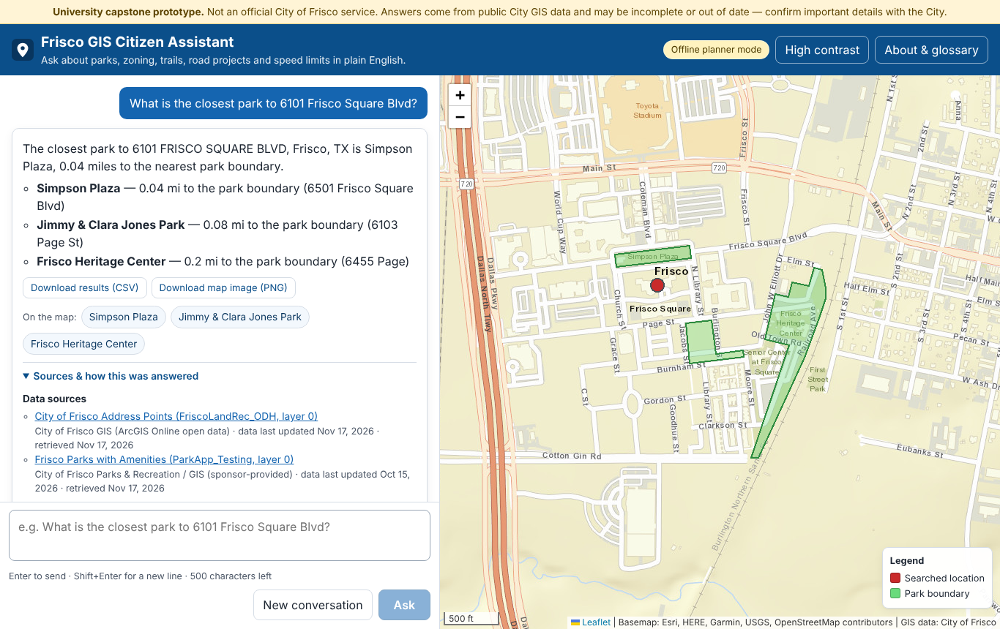
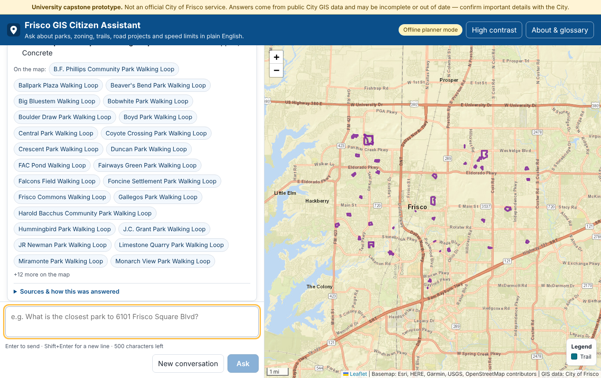
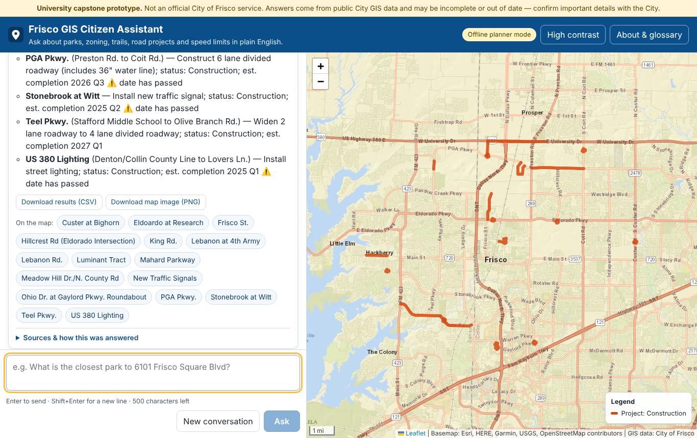
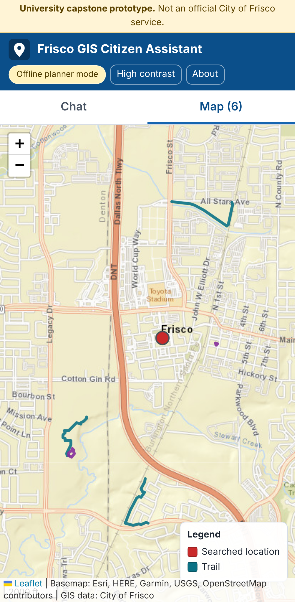

# Frisco GIS Citizen Query Assistant (MCP)

> **University capstone prototype.** Not an official or endorsed City of Frisco service. Answers come from the City's *public* GIS data and may be incomplete or out of date.

Residents ask everyday questions such as *"What is the closest park to 6101 Frisco Square Blvd?"*, *"Which of those also have playgrounds?"* or *"What's the speed limit on Preston Road?"*. Each answer comes back in plain English with an interactive map, the City data layers it came from (with last-updated dates), and a short explanation of how it was derived.

All GIS access goes through a genuine **Model Context Protocol (MCP)** server, which exposes 13 validated, read-only tools over the City of Frisco's ArcGIS REST services. The backend connects to it with the official **MCP client**, and a language model (Claude) chooses which tools to call.

```
Citizen → Web UI → Backend API → AI assistant (Claude) → MCP client ⇄(stdio)⇄ MCP server → City ArcGIS REST → answer + map + sources
```



## Contents
- [Status of the 10 use cases](#status-of-the-10-use-cases)
- [Technology stack](#technology-stack)
- [Repository layout](#repository-layout)
- [Installation](#installation)
- [Configuration (environment variables)](#configuration-environment-variables)
- [AI provider](#ai-provider)
- [Running](#running)
- [Testing](#testing)
- [Using the application](#using-the-application)
- [Using the MCP server from other clients](#using-the-mcp-server-from-other-clients)
- [Troubleshooting](#troubleshooting)
- [Documentation](#documentation)

## Status of the 10 use cases

| # | Use case | Status | Verified live example |
|---|---|---|---|
| 1 | Nearest park | ✅ Supported | Simpson Plaza, 0.04 mi to boundary |
| 2 | Parks within a radius | ✅ Supported | 19 parks within 2 mi |
| 3 | Parks by amenity | ✅ Supported | 35 parks with basketball |
| 4 | Follow-up filtering | ✅ Supported | 34 of those 35 also have playgrounds |
| 5 | Property zoning | ✅ Supported | MIXED (Mixed Use), PD-153 |
| 6 | Nearby trails | ✅ Supported | 5 trails within 1 mi |
| 7 | Trails by type (walking loops) | ✅ Supported | 36 walking loops |
| 8 | Active road construction | ⚠️ Partial | 17 City CIP road projects (9 flagged as possibly stale) |
| 9 | Road projects near an address | ⚠️ Partial | 5 projects within 1 mi |
| 10 | Street speed limits | ✅ Supported | Preston Rd: 45/55 mph, so the assistant asks which stretch |

Details and evidence: [docs/USE_CASE_FEASIBILITY.md](docs/USE_CASE_FEASIBILITY.md) and [docs/TEST_REPORT.md](docs/TEST_REPORT.md).

## Technology stack

| Layer | Technology |
|---|---|
| MCP server | Node.js 22, TypeScript, `@modelcontextprotocol/sdk` 1.32 (stdio and Streamable HTTP), zod 4, Turf.js 7 |
| Backend | Express 5, `@modelcontextprotocol/sdk` client, `@anthropic-ai/sdk` (Claude `claude-opus-5-5`), helmet, express-rate-limit |
| Frontend | React 19, Vite 8, Leaflet 1.9 / react-leaflet 5, react-markdown, Esri World Street Map basemap |
| GIS data | City of Frisco ArcGIS Online and City ArcGIS Server (public, read-only); Esri World and U.S. Census geocoders as fallbacks |
| Tests | Vitest, supertest, Playwright 1.63, axe-core |

## Repository layout

```
packages/mcp-server   MCP server: ArcGIS client, layer registry, geometry, 13 tools, tests
apps/backend          Express API, MCP client, Claude orchestrator, offline planner, tests
apps/web              React + Leaflet citizen UI
e2e/                  Playwright browser tests
scripts/              gis-discovery.ts (data inventory evidence), dev.mjs (dev launcher)
examples/             Claude Desktop config, MCP-over-HTTP curl example
docs/                 Architecture, GIS inventory, feasibility, tools, security, test report, screenshots
```

## Installation

Requirements: **Node.js ≥ 20.10** (22 LTS recommended) and npm 10. Internet access to `services6.arcgis.com`, `maps.friscotexas.gov`, `geocode.arcgis.com`, `geocoding.geo.census.gov` and `server.arcgisonline.com` (basemap tiles).

```bash
git clone https://github.com/pgajera31/frisco-gis-citizen-assistant.git
cd frisco-gis-citizen-assistant
npm install            # installs all three workspaces
cp .env.example .env   # then edit .env (see below)
npm run build          # builds MCP server, backend and web app
```

## Configuration (environment variables)

All settings live in `.env` at the repository root (git-ignored). See [.env.example](.env.example).

| Variable | Default | Purpose |
|---|---|---|
| `ANTHROPIC_API_KEY` | *(empty)* | Enables the AI assistant. Without it, the app runs the **offline planner** mode. |
| `CLAUDE_MODEL` | `claude-opus-5-5` | Claude model used for tool selection and answers |
| `CLAUDE_EFFORT` | `medium` | Claude effort level (`low` … `max`) |
| `ASSISTANT_MODE` | `auto` | `auto` (AI if a key is set), `ai`, or `offline` |
| `PORT` | `8787` | Backend port (also serves the built web app) |
| `CORS_ORIGINS` | `http://localhost:5173` | Allowed browser origins in development |
| `RATE_LIMIT_PER_MINUTE` | `30` | Chat requests per minute per IP |
| `SESSION_TTL_MINUTES` | `30` | Idle conversation lifetime |
| `ARCGIS_TIMEOUT_MS` | `20000` | Per-request ArcGIS timeout |
| `GIS_CACHE_TTL_SECONDS` | `900` | Cache lifetime for whole-layer downloads (parks, trails, CIP) |
| `ENABLE_ESRI_GEOCODER` / `ENABLE_CENSUS_GEOCODER` | `1` | Allow fallback geocoders |
| `MCP_SERVER_COMMAND` / `MCP_SERVER_ARGS` | built server | Override how the backend launches the MCP server |

Never commit `.env` or put keys in frontend code. The API key is read only by the backend and is **not** passed to the MCP server process.

## AI provider

1. Create an API key in the Anthropic Console.
2. Put it in `.env` as `ANTHROPIC_API_KEY=...`.
3. Restart the backend. The startup log says `assistant mode: ai, model claude-opus-5-5`, and the header badge reads **"AI assistant"**.

How it works: the backend lists the MCP server's tools (`tools/list`), passes them to Claude as tool definitions, runs each `tool_use` through the MCP client, and returns the results to Claude as `tool_result` blocks until Claude answers (at most 6 tool rounds). If the AI provider is unavailable, that turn falls back to the offline planner and says so. Requests use server-side refusal fallbacks (`fallbacks: "default"`).

**Offline planner mode** (no key) recognises the 10 supported question types and common variations and calls the same MCP tools. It exists so the full pipeline can be demonstrated and tested without a key, and it is labelled "Offline planner mode" in the UI. It is not a substitute for the AI model.

## Running

**Production-style (single process, recommended for demos):**
```bash
npm run build
npm start                     # backend on http://localhost:8787; spawns the MCP server over stdio and serves the web app
```
Open <http://localhost:8787>.

**Development (hot reload):**
```bash
npm run dev                   # backend (tsx watch) + Vite on http://localhost:5173 (proxies /api to :8787)
```

**Start the parts individually:**
```bash
npm run start -w packages/mcp-server              # MCP server on stdio (usually started by the backend)
npm run start -w packages/mcp-server -- --http    # MCP server on http://127.0.0.1:8788/mcp (Streamable HTTP)
npm run start -w apps/backend                     # backend API (launches its own MCP server)
npm run dev -w apps/web                           # web UI dev server
```

Health check: `curl http://localhost:8787/api/health` returns `{"status":"ok","mode":"offline|ai","mcp":{"connected":true,"toolCount":13,"transport":"stdio"}}`.

## Testing

```bash
npm test                      # unit + mocked + MCP protocol tests (no network needed)
LIVE_GIS=1 npm test           # also runs live tests against City of Frisco ArcGIS services
npm run build && npm run test:e2e   # Playwright browser tests (starts the backend automatically)
npm run typecheck             # TypeScript across all workspaces
npm run inventory             # re-run GIS data discovery → docs/gis-discovery/
```

Latest results (2026-11-17): **174 tests passed, 0 failed**, including 26 live-GIS tests and 10 browser tests. See [docs/TEST_REPORT.md](docs/TEST_REPORT.md).

## Using the application

1. Pick a suggested question or type your own, using any Frisco address or landmark.
2. Read the answer, then open **"Sources & how this was answered"** to see the data layers (with links and last-updated dates), the method, the limitations, and the MCP tools that ran.
3. Click a result chip under the answer to highlight it on the map. Click features on the map for details.
4. Ask follow-ups such as *"Which of those also have playgrounds?"*, *"What's the zoning there?"* or *"…near 8750 Preston Rd?"*.
5. Use **High contrast** for a high-contrast theme and **About & glossary** for plain-language GIS terms. On phones, switch between **Chat** and **Map** with the tabs.

| Walking loops | Road construction | Speed limit (mobile) |
|---|---|---|
|  |  |  |

## Using the MCP server from other clients

The MCP server works with any MCP client. For **Claude Desktop**, build the project and add the following to `claude_desktop_config.json` (see [examples/claude_desktop_config.json](examples/claude_desktop_config.json)):

```json
{ "mcpServers": { "frisco-gis": { "command": "node", "args": ["/ABSOLUTE/PATH/packages/mcp-server/dist/index.js"] } } }
```

Tool catalog and schemas: [docs/MCP_TOOLS.md](docs/MCP_TOOLS.md). HTTP example: [examples/mcp-http-request.sh](examples/mcp-http-request.sh).

## Troubleshooting

| Symptom | Fix |
|---|---|
| Header shows **"Server offline"** or the GIS service banner | Check that the backend is running (`npm start`) and `curl localhost:8787/api/health`. If `mcp.connected` is false, run `npm run build -w packages/mcp-server` and check the backend log for MCP server errors. |
| Every question fails with "The City GIS service could not be reached" | Your network blocks the ArcGIS hosts listed in [Installation](#installation). Behind a corporate proxy, set `HTTPS_PROXY` and `NODE_USE_ENV_PROXY=1` (Node ≥ 22.21 / 24) so Node's `fetch` uses the proxy, and `NODE_EXTRA_CA_CERTS` if the proxy re-signs TLS. These variables are forwarded to the MCP server. |
| Badge says **Offline planner mode** although you set a key | Make sure `.env` is in the repository root and contains `ANTHROPIC_API_KEY`, `ASSISTANT_MODE` is not `offline`, and restart the backend. |
| "The AI service is unavailable right now…" | The Claude API returned an error (invalid key, rate limit, outage). Check the backend log line `[chat] AI unavailable (<reason>)`. |
| `EADDRINUSE :8787` | Another backend is running. Stop it or set `PORT`. |
| Map tiles don't load | The browser cannot reach `server.arcgisonline.com`. Answers still work, but the basemap is blank. |
| Playwright cannot find a browser | Run `npx playwright install chromium` (local machines). |
| HTTP 429 "Too many questions" | Rate limit reached. Wait a minute or raise `RATE_LIMIT_PER_MINUTE` for demos. |

## Documentation

- [docs/ARCHITECTURE.md](docs/ARCHITECTURE.md): components, sequence diagram, design decisions, API contract
- [docs/GIS_DATA_INVENTORY.md](docs/GIS_DATA_INVENTORY.md): every dataset with URL, schema, sample query/response, freshness, limitations
- [docs/USE_CASE_FEASIBILITY.md](docs/USE_CASE_FEASIBILITY.md): feasibility matrix with evidence
- [docs/MCP_TOOLS.md](docs/MCP_TOOLS.md): tool catalog and how to add tools
- [docs/SECURITY.md](docs/SECURITY.md): security and privacy controls and remaining risks
- [docs/TEST_REPORT.md](docs/TEST_REPORT.md): per-use-case results and category coverage
- [docs/LIMITATIONS_AND_ROADMAP.md](docs/LIMITATIONS_AND_ROADMAP.md): known limitations and next steps
- [docs/gis-discovery/summary.md](docs/gis-discovery/summary.md): auto-generated discovery evidence

Data © City of Frisco (public GIS services). Basemap © Esri and contributors. This prototype is not affiliated with or endorsed by the City of Frisco.
