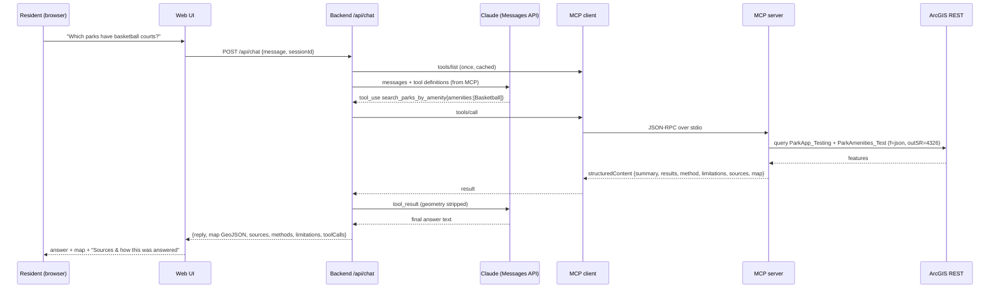

# System Architecture

```
Citizen ─► Web UI (React + Leaflet) ─► Backend API (Express) ─► AI orchestrator (Claude, tool use)
                                                     │                       │ selects tools
                                                     │                       ▼
                                                     └──────────► MCP client (official SDK)
                                                                             │ stdio (JSON-RPC)
                                                                             ▼
                                                              MCP server "frisco-gis-mcp"
                                                              21 read-only GIS tools
                                                                             │ HTTPS (allow-listed)
                                                                             ▼
                                                 City of Frisco ArcGIS REST services (+ geocoders)
```



## Components

| Component | Path | Responsibility | Key technology |
|---|---|---|---|
| **MCP server** | `packages/mcp-server` | Exposes 21 validated, read-only GIS tools. Owns every ArcGIS request, geocoding, spatial maths, and source citation. | `@modelcontextprotocol/sdk` (McpServer, stdio and Streamable HTTP), zod schemas, Turf.js |
| ArcGIS client | `…/src/arcgis/client.ts` | Endpoint allowlist, HTTPS only, timeouts, retry with backoff, ArcGIS-error-in-200 detection, pagination, caching, SQL-literal escaping | `fetch` |
| Layer registry | `…/src/arcgis/layers.ts` | The only layers the server may query (URL, title, publisher, notes) | — |
| Tools | `…/src/tools/*.ts` | Parks, zoning, future land use, school districts, schools, public facilities, trails, road projects, speed limits, geocoding, data-source catalog, City GIS item search, buffer/count, map image | Turf (geodesic distances, point-in-polygon, buffers); Esri Export Web Map GP task for PNG rendering |
| **Backend** | `apps/backend` | HTTP API, sessions, rate limiting, security headers, the **MCP client**, the AI orchestrator, and the offline planner | Express 5, helmet, express-rate-limit, `@anthropic-ai/sdk` |
| MCP client | `…/src/mcp/client.ts` | Spawns the MCP server (stdio), discovers tools, calls them with timeouts, reconnects | MCP SDK `Client` + `StdioClientTransport` |
| AI orchestrator | `…/src/assistant/claude.ts` | Manual tool-use loop: tools come from MCP `tools/list`; parallel `tool_use` blocks run concurrently; results return as `tool_result` | Claude `claude-opus-5-5`, adaptive thinking, effort `medium`, server-side refusal fallback |
| Offline planner | `…/src/assistant/offline.ts` | **Fallback only** (no API key, or AI outage): regex/vocabulary routing to the same MCP tools | — |
| **Web UI** | `apps/web` | Chat, suggestions, map, result selection, provenance disclosure, accessibility | React 19, Vite, Leaflet / react-leaflet, react-markdown |

## Key design decisions

1. **The MCP server is the only component that talks to ArcGIS.** The browser never calls GIS services, and the backend reaches GIS data only through MCP `tools/call`. This enforces one security boundary (the allowlist) and makes the tools reusable from any MCP client (Claude Desktop, IDEs). See `examples/claude_desktop_config.json`.
2. **stdio transport** between backend and MCP server. It's simple, needs no network port, and the server process gets a minimal environment (the API key is *not* forwarded). A stateless **Streamable HTTP** transport (`--http`, localhost-bound with DNS-rebinding protection) is available for networked deployments.
3. **Tools return answers, not raw data.** Each result carries `summary`, `results`, `method` (how it was derived), `limitations`, `sources` (layer, URL, publisher, last-edit date, retrieval time) and `map` (GeoJSON). The model gets a compact copy without geometry; the browser gets the GeoJSON. This keeps the model grounded and makes the proposal's transparency criterion ("cites layer + timestamp + how it was derived") a property of the tool layer rather than of the prompt.
4. **Geographic accuracy choices**
   - Server-side reprojection (`outSR/inSR=4326`); no hand-rolled projections.
   - Geodesic distances with Turf. Distance to a park = distance to the nearest polygon edge (0 if inside), with the centroid distance shown for comparison.
   - Radius membership = any part of the feature within R.
   - Zoning = point-in-polygon on the address point, cross-checked across two zoning layers.
   - Amenity points joined to parks spatially, not by name (names disagree in 23 of 477 cases).
   - Speed limits grouped by segment, with clarification when they differ.
5. **Geocoding priority**: City address points (authoritative), then Esri World Geocoder (restricted to the Frisco area), then U.S. Census. The source used is always cited.
6. **Conversation context**: in AI mode the backend keeps an append-only message history per session (stable system prompt and tool list, so prompt caching and thinking-block validity hold). Long sessions strip all thinking blocks before trimming whole turns from the front. In offline mode the session stores the last park IDs/amenities/address.
7. **Graceful degradation**: AI provider errors make the turn fall back to the offline planner with a visible note. MCP outages return HTTP 503 with a friendly message. ArcGIS layers with mirrors (CIP, speed limits) fall back automatically.

## Request/response contract (`POST /api/chat`)

Request: `{ "message": "≤500 chars", "sessionId": "uuid (optional)" }`

Response:
```json
{
  "sessionId": "…",
  "reply": "Markdown answer",
  "mode": "ai | offline",
  "toolCalls": [{ "tool": "find_nearest_parks", "arguments": {…}, "ok": true, "durationMs": 640 }],
  "map": { "type": "FeatureCollection", "features": [{ "properties": { "kind": "park", "id": "park-21", "label": "Simpson Plaza", "details": ["…"] } }] },
  "sources": [{ "layer": "…", "url": "…", "publisher": "…", "lastEdited": "2026-10-15T…", "retrievedAt": "…" }],
  "methods": ["Distance is the straight-line …"],
  "limitations": ["…"],
  "clarification": { "reason": "…", "options": ["45 mph section (addresses 2300–8999)", "…"] }
}
```

The response also carries `tables` (the result rows of each successful tool, used for CSV export).

Other endpoints:
- `GET /api/health`: mode, model, MCP connection and tool count.
- `GET /api/tools`: the MCP-discovered tool list.
- `GET /api/status`: per-service health of every City layer, via the MCP `check_data_sources_health` tool (single 8 s probe per layer, cached 2 minutes). It drives the UI banner that names the questions affected by an outage. Layers covered by a working backup are not reported as outages.
- `POST /api/map-image {sessionId}`: renders the session's **latest answer** as a PNG by calling the MCP `get_map_image` tool. The browser cannot submit geometry; only the server-held result is drawn.
- `DELETE /api/session/:id`.

## Observability

- The MCP server logs one JSON line per tool call to stderr: `{"evt":"tool","tool":…,"ok":…,"ms":…,"count":…}`.
- The backend logs one JSON line per chat turn: `{"evt":"chat","mode":…,"ms":…,"tools":[…],"chars":…}`. It logs message *length* only, never message content.
